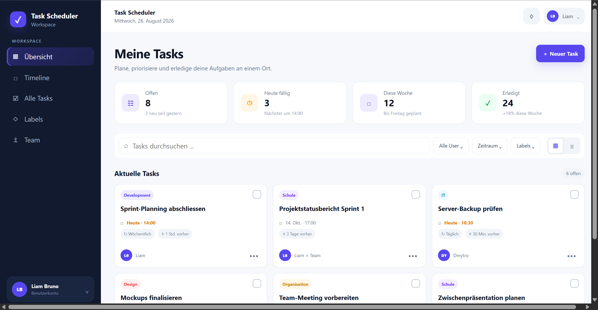
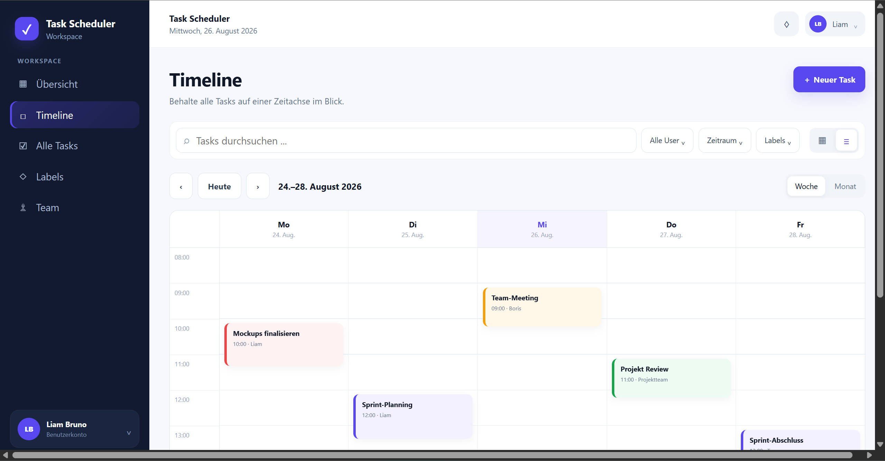
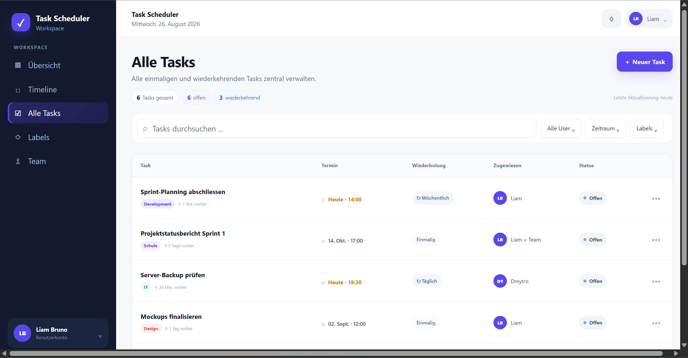
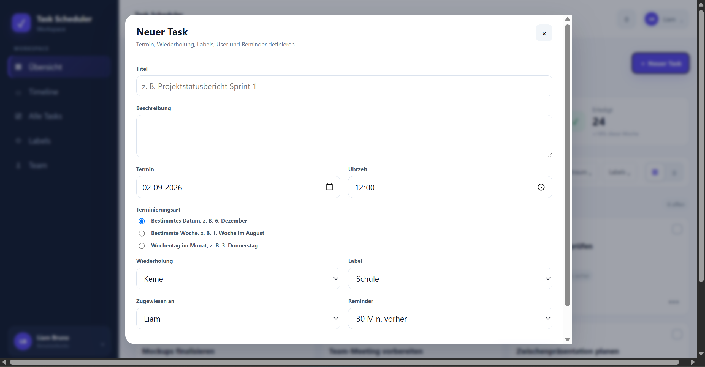
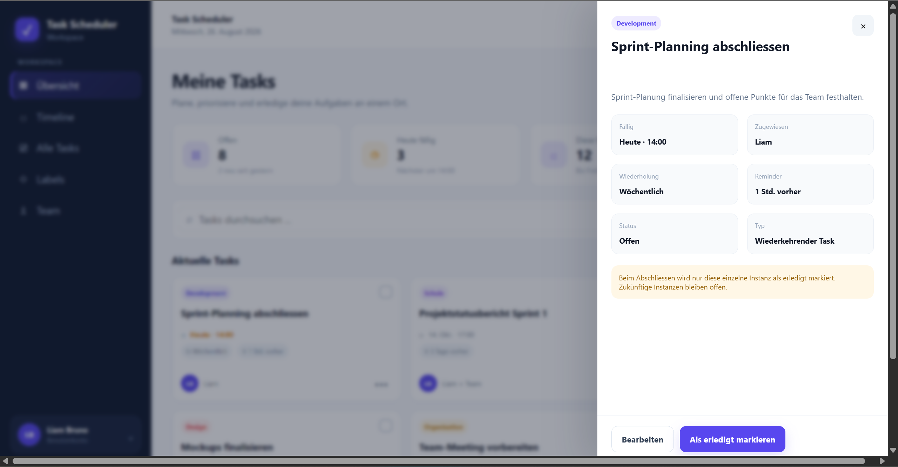
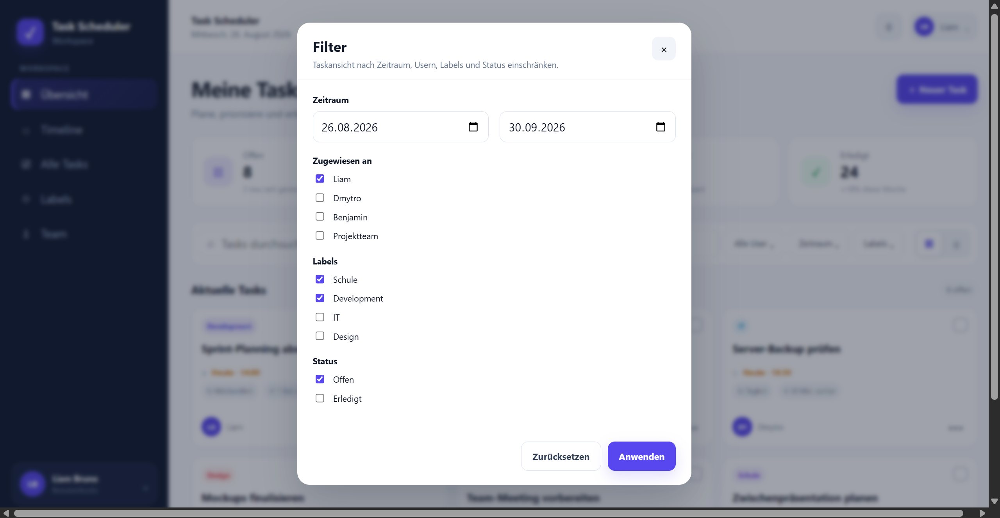
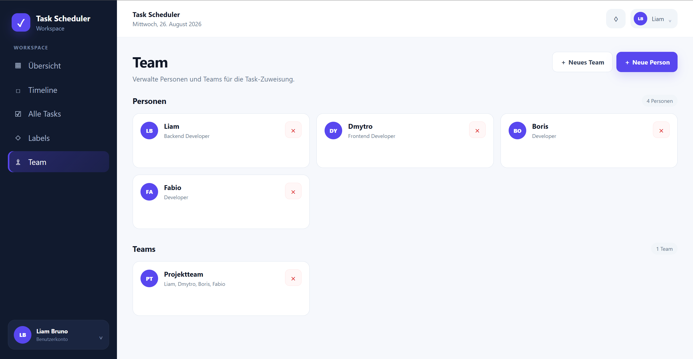
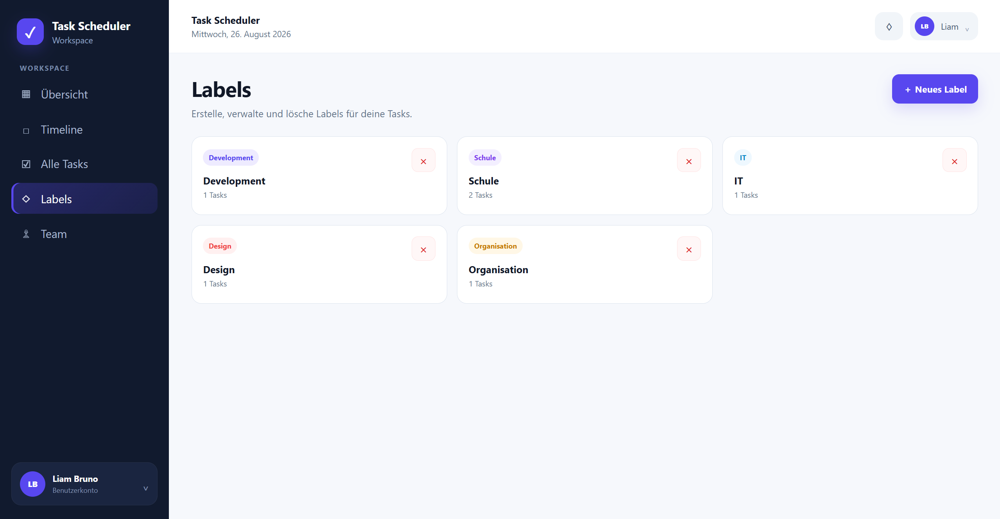

# Pflichtenheft

## Dokumentinformationen

Projektname: Task-Scheduler\
Auftraggeber: Lagger Stefan\
Datum: 26.08.2026

---

# 1. Einleitung

Der Task-Scheduler ist eine Anwendung zur Erfassung, Planung und Verwaltung von Aufgaben. Benutzer können einmalige sowie wiederkehrende Tasks erstellen, terminieren und anderen Benutzern zuweisen.

Zusätzlich können Reminder eingerichtet werden, welche vor dem Fälligkeitsdatum per E-Mail versendet werden.

Das System soll verschiedene Darstellungs- und Filtermöglichkeiten bieten, damit auch eine grössere Anzahl von Tasks übersichtlich verwaltet werden kann.

### Muss-Ziele

- Tasks können erfasst und verwaltet werden.
- Tasks können terminiert werden.
- Es können unterschiedliche Terminierungsarten verwendet werden, z. B. ein bestimmtes Datum, eine bestimmte Woche oder ein bestimmter Wochentag im Monat.
- Tasks können Wiederholungsintervalle erhalten, z. B. täglich oder wöchentlich.
- Tasks können mit Labels versehen werden.
- Tasks können Benutzern zugeteilt werden.
- Für Tasks können Reminder eingestellt werden.
- Reminder werden per E-Mail versendet.
- Tasks können als abgeschlossen markiert werden.
- Bei wiederkehrenden Tasks können einzelne Instanzen unabhängig voneinander als abgeschlossen markiert werden.
- Tasks können auf einer Zeitachse dargestellt werden.
- Tasks können als Kacheln dargestellt werden.
- Die Taskansichten können gefiltert werden.
- Filter können unter anderem nach Zeitraum, zugeteiltem Benutzer und Text gesetzt werden.

### Kann-Ziele

- Weitere Reminder-Arten ergänzen.
- Zusätzliche Filterkriterien anbieten.
- Zusätzliche Darstellungsarten für Tasks anbieten.
- Dark-/Hellmodus anbieten.

---

# 2. Systemübersicht

## 2.1 Projektbeschreibung

Der Task-Scheduler ist eine Anwendung zur zentralen Verwaltung und Planung von Aufgaben.

Benutzer können Tasks erstellen und diese mit einem Termin, Wiederholungsintervall, Labels, zuständigen Benutzern und Remindern versehen.

Die Terminierung unterstützt neben festen Daten auch speziellere Angaben, beispielsweise:

- 6. Dezember
- 1. Woche im August
- 3. Donnerstag im Monat

Tasks können sich in definierten Intervallen wiederholen, beispielsweise täglich oder wöchentlich.

Bei wiederkehrenden Tasks wird jede einzelne Instanz separat behandelt. Dadurch kann beispielsweise ein Task dieser Woche als abgeschlossen markiert werden, während zukünftige Instanzen weiterhin offen bleiben.

Zur Darstellung der Tasks gibt es eine Zeitachsenansicht und eine Kachelansicht. Zusätzlich können Filter verwendet werden, um nur bestimmte Tasks anzuzeigen.

## 2.2 Systemkontext

### Beteiligte Rollen

| Rolle | Beschreibung |
|-------|--------------|
| Benutzer | Erstellt und verwaltet Tasks, betrachtet zugewiesene Tasks, verwendet Reminder und markiert Tasks als abgeschlossen. |
| Administrator | Verwaltet das System und die Benutzer und besitzt erweiterte Verwaltungsrechte. |
| Kunde | Auftraggeber des Projekts und definiert die Anforderungen an das System. |

---

# 3. Funktionale Anforderungen

## 3.1 Übersicht

| ID | Anforderung | Priorität |
|----|-------------|-----------|
| F001 | Tasks erfassen | Muss |
| F002 | Tasks terminieren | Muss |
| F003 | Wiederholungsintervalle definieren | Muss |
| F004 | Labels vergeben | Muss |
| F005 | Tasks Benutzern zuweisen | Muss |
| F006 | Reminder einstellen | Muss |
| F007 | Reminder per E-Mail versenden | Muss |
| F008 | Tasks als abgeschlossen markieren | Muss |
| F009 | Einzelne Instanzen wiederkehrender Tasks abschliessen | Muss |
| F010 | Zeitachsenansicht | Muss |
| F011 | Kachelansicht | Muss |
| F012 | Tasks filtern | Muss |

---

## F001 – Tasks erfassen

**Beschreibung**

Benutzer können neue Tasks im System erfassen und bestehende Tasks verwalten.

**Akzeptanzkriterien**

- Ein neuer Task kann erstellt werden.
- Die eingegebenen Taskinformationen werden gespeichert.
- Der erstellte Task wird anschliessend in den Taskansichten angezeigt.

---

## F002 – Tasks terminieren

**Beschreibung**

Tasks können für einen bestimmten Zeitpunkt oder Zeitraum terminiert werden.

Neben einem konkreten Datum sollen auch Terminierungen wie eine bestimmte Woche oder ein bestimmter Wochentag innerhalb eines Monats möglich sein.

Beispiele:

- 6. Dezember
- 1. Woche im August
- 3. Donnerstag im Monat

**Akzeptanzkriterien**

- Ein Task kann mit einem konkreten Datum versehen werden.
- Ein Task kann für eine bestimmte Woche terminiert werden.
- Ein Task kann für einen bestimmten Wochentag innerhalb eines Monats terminiert werden.
- Der berechnete Termin wird korrekt angezeigt.

---

## F003 – Wiederholungsintervalle definieren

**Beschreibung**

Für Tasks können Wiederholungsintervalle definiert werden.

Beispiele sind:

- täglich
- wöchentlich
- weitere wiederkehrende Intervalle

**Akzeptanzkriterien**

- Für einen Task kann ein Wiederholungsintervall ausgewählt werden.
- Wiederkehrende Tasks erscheinen entsprechend dem definierten Intervall.
- Tasks ohne Wiederholungsintervall werden nur einmal eingeplant.

---

## F004 – Labels vergeben

**Beschreibung**

Tasks können mit Labels versehen werden, um sie zu kategorisieren und einfacher unterscheiden zu können.

**Akzeptanzkriterien**

- Einem Task kann mindestens ein Label zugewiesen werden.
- Die Labels werden beim entsprechenden Task angezeigt.
- Die Labels bleiben nach dem Speichern erhalten.

---

## F005 – Tasks Benutzern zuweisen

**Beschreibung**

Tasks können Benutzern zugeteilt werden.

Dadurch ist ersichtlich, welcher Benutzer für einen bestimmten Task verantwortlich ist.

**Akzeptanzkriterien**

- Ein Task kann einem Benutzer zugewiesen werden.
- Der zugewiesene Benutzer wird beim Task angezeigt.
- Die Zuweisung bleibt nach dem Speichern erhalten.

---

## F006 – Reminder einstellen

**Beschreibung**

Für einen Task können Reminder definiert werden.

Ein Reminder wird eine bestimmte Zeit vor dem eigentlichen Task-Termin ausgelöst.

Beispiel:

- 3 Tage vor dem Termin

**Akzeptanzkriterien**

- Für einen Task kann ein Reminder eingestellt werden.
- Der zeitliche Abstand zum Task-Termin kann definiert werden.
- Der Zeitpunkt des Reminders wird anhand des Task-Termins korrekt berechnet.

---

## F007 – Reminder per E-Mail versenden

**Beschreibung**

Wenn der Zeitpunkt eines Reminders erreicht wird, wird automatisch eine E-Mail an den entsprechenden Benutzer versendet.

**Akzeptanzkriterien**

- Der Reminder wird zum definierten Zeitpunkt ausgelöst.
- Es wird automatisch eine E-Mail versendet.
- Die E-Mail gehört zum richtigen Task.
- Die E-Mail wird an den vorgesehenen Benutzer gesendet.

---

## F008 – Tasks als abgeschlossen markieren

**Beschreibung**

Benutzer können erledigte Tasks als abgeschlossen markieren.

**Akzeptanzkriterien**

- Ein offener Task kann als abgeschlossen markiert werden.
- Der Abschlussstatus wird gespeichert.
- Abgeschlossene Tasks sind in der Benutzeroberfläche erkennbar.

---

## F009 – Einzelne Instanzen wiederkehrender Tasks abschliessen

**Beschreibung**

Bei wiederkehrenden Tasks können einzelne Instanzen unabhängig voneinander als abgeschlossen markiert werden.

Wird eine einzelne Instanz abgeschlossen, werden zukünftige Instanzen des Tasks nicht automatisch ebenfalls abgeschlossen.

**Akzeptanzkriterien**

- Eine einzelne Instanz kann als abgeschlossen markiert werden.
- Andere Instanzen desselben Tasks bleiben unverändert.
- Zukünftige Instanzen bleiben weiterhin offen.
- Der Abschlussstatus der einzelnen Instanz wird gespeichert.

---

## F010 – Zeitachsenansicht

**Beschreibung**

Tasks können auf einer Zeitachse dargestellt werden.

Dadurch erhält der Benutzer eine zeitliche Übersicht über anstehende Tasks.

**Akzeptanzkriterien**

- Terminierte Tasks werden auf einer Zeitachse dargestellt.
- Die Position eines Tasks entspricht seinem Termin.
- Mehrere Tasks können gleichzeitig dargestellt werden.

---

## F011 – Kachelansicht

**Beschreibung**

Tasks können alternativ in einer Kachelansicht dargestellt werden.

Jeder Task wird dabei als eigene Kachel angezeigt.

**Akzeptanzkriterien**

- Jeder Task wird als eigene Kachel dargestellt.
- Wichtige Informationen des Tasks sind auf der Kachel sichtbar.
- Mehrere Tasks können übersichtlich dargestellt werden.

---

## F012 – Tasks filtern

**Beschreibung**

Die Taskansichten können mithilfe verschiedener Filter eingeschränkt werden.

Mindestens folgende Filtermöglichkeiten werden unterstützt:

- Zeitraum
- zugeteilter Benutzer
- Text

**Akzeptanzkriterien**

- Tasks können nach Zeitraum gefiltert werden.
- Tasks können nach zugeteiltem Benutzer gefiltert werden.
- Tasks können anhand eines Textes gesucht beziehungsweise gefiltert werden.
- Es werden nur Tasks angezeigt, die den gewählten Kriterien entsprechen.

---

# 4. Nichtfunktionale Anforderungen

## 4.1 Übersicht

| ID | Anforderung | Priorität |
|----|-------------|-----------|
| NF001 | Benutzerfreundlichkeit | Muss |
| NF002 | Zuverlässigkeit | Muss |
| NF003 | Performance | Muss |
| NF004 | Sicherheit | Muss |
| NF005 | Erweiterbarkeit | Kann |

---

## NF001 – Benutzerfreundlichkeit

**Beschreibung**

Die Anwendung soll übersichtlich aufgebaut und einfach zu bedienen sein.

Benutzer sollen die wichtigsten Funktionen ohne lange Einarbeitung verwenden können.

**Akzeptanzkriterien**

- Die wichtigsten Funktionen sind einfach erreichbar.
- Tasks können mit wenigen Schritten erstellt werden.
- Termine, Status und zugewiesene Benutzer sind klar erkennbar.
- Die verschiedenen Taskansichten können einfach gewechselt werden.

---

## NF002 – Zuverlässigkeit

**Beschreibung**

Tasks, Termine, Wiederholungen, Zuweisungen und Reminder müssen zuverlässig gespeichert und verarbeitet werden.

**Akzeptanzkriterien**

- Gespeicherte Tasks bleiben erhalten.
- Wiederholungen werden korrekt berechnet.
- Abschlussstatus von Tasks und einzelnen Instanzen gehen nicht verloren.
- Reminder werden anhand der gespeicherten Einstellungen ausgelöst.

---

## NF003 – Performance

**Beschreibung**

Die Anwendung soll auch bei mehreren Tasks flüssig bedienbar sein.

**Akzeptanzkriterien**

- Taskansichten werden ohne starke Verzögerung geladen.
- Filter werden ohne starke Verzögerung angewendet.
- Der Wechsel zwischen Kachel- und Zeitachsenansicht erfolgt flüssig.

---

## NF004 – Sicherheit

**Beschreibung**

Benutzer- und Taskdaten sollen vor unberechtigtem Zugriff geschützt werden.

**Akzeptanzkriterien**

- Benutzer können nur auf erlaubte Funktionen zugreifen.
- Administrative Funktionen sind nur für Administratoren verfügbar.
- Benutzerdaten werden nicht unberechtigt offengelegt.

---

## NF005 – Erweiterbarkeit

**Beschreibung**

Das System soll so aufgebaut sein, dass später weitere Funktionen ergänzt werden können.

Dazu gehören beispielsweise zusätzliche Wiederholungsintervalle, Reminder-Arten oder Ansichten.

**Akzeptanzkriterien**

- Neue Intervalltypen können ergänzt werden.
- Neue Reminder-Optionen können ergänzt werden.
- Neue Taskansichten können ergänzt werden.

---

# 5. Benutzeroberfläche

## 5.1 Mockups

Die folgenden Mockups zeigen die wichtigsten Ansichten und Funktionen des Task-Schedulers.

### Dashboard / Kachelansicht

Das Dashboard zeigt die aktuellen Tasks als Kacheln. Termine, Labels, zugewiesene Benutzer, Wiederholungen und Reminder sind direkt sichtbar. Zusätzlich können Tasks gesucht und gefiltert werden.

---

### Timeline / Zeitachsenansicht

In der Timeline werden die Tasks auf einer Zeitachse dargestellt. Dadurch ist ersichtlich, an welchem Tag und zu welcher Uhrzeit die einzelnen Tasks geplant sind.

---

### Alle Tasks

Die Ansicht zeigt alle einmaligen und wiederkehrenden Tasks in einer übersichtlichen Liste. Angezeigt werden unter anderem Termin, Wiederholung, zugewiesener Benutzer und Status.

---

### Task erstellen

Beim Erstellen eines Tasks können Titel, Beschreibung, Termin, Wiederholung, Label, Benutzer und Reminder festgelegt werden. Auch spezielle Terminierungsarten wie eine bestimmte Woche oder ein bestimmter Wochentag im Monat können gewählt werden.

---

### Task-Details

Die Detailansicht zeigt alle Informationen eines Tasks. Bei wiederkehrenden Tasks kann eine einzelne Instanz abgeschlossen werden, ohne dass zukünftige Instanzen ebenfalls abgeschlossen werden.

---

### Filter

Mit den Filtern können die angezeigten Tasks nach Zeitraum, Benutzer, Labels und Status eingeschränkt werden.

---

### Teamverwaltung

In der Teamverwaltung werden die vorhandenen Personen und Teams angezeigt. Neue Personen und Teams können erstellt und bestehende Einträge gelöscht werden.

---

### Labelverwaltung

In der Labelverwaltung können Labels für die Kategorisierung von Tasks erstellt und gelöscht werden. Zusätzlich wird angezeigt, wie viele Tasks einem Label zugeordnet sind.

# 6. Projektplanung

## Sprints

| Sprint | Zeitraum |
|--------|----------|
| Sprint 1 | 02.09.2026 – 14.10.2026 |
| Sprint 2 | 21.10.2026 – 18.11.2026 |
| Sprint 3 | 25.11.2026 – 13.01.2027 |

## Meilensteine

| Datum | Meilenstein |
|-------|-------------|
| 25.08.2026 | Projektteam und GitHub eingerichtet |
| 02.09.2026 | Pflichtenheft mit Projektbeschreibung und Mockups eingereicht |
| 14.10.2026 | Projektstatusbericht Sprint 1 abgegeben |
| 18.11.2026 | Projektstatusbericht Sprint 2 abgegeben |
| 24.11.2026 | Zwischenpräsentation als Video abgegeben |
| 13.01.2027 | Sprint 3 abgeschlossen |
| 20.01.2027 | Produktpräsentation |